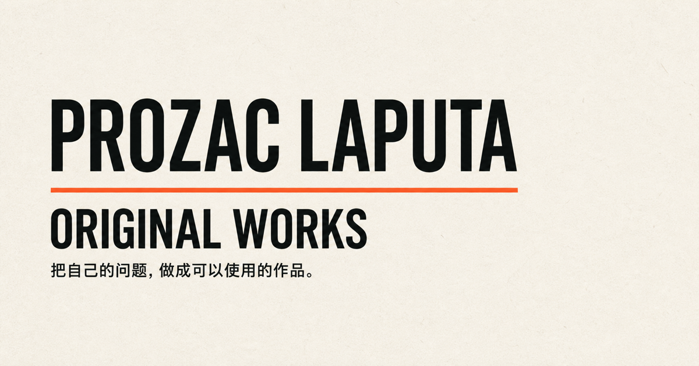
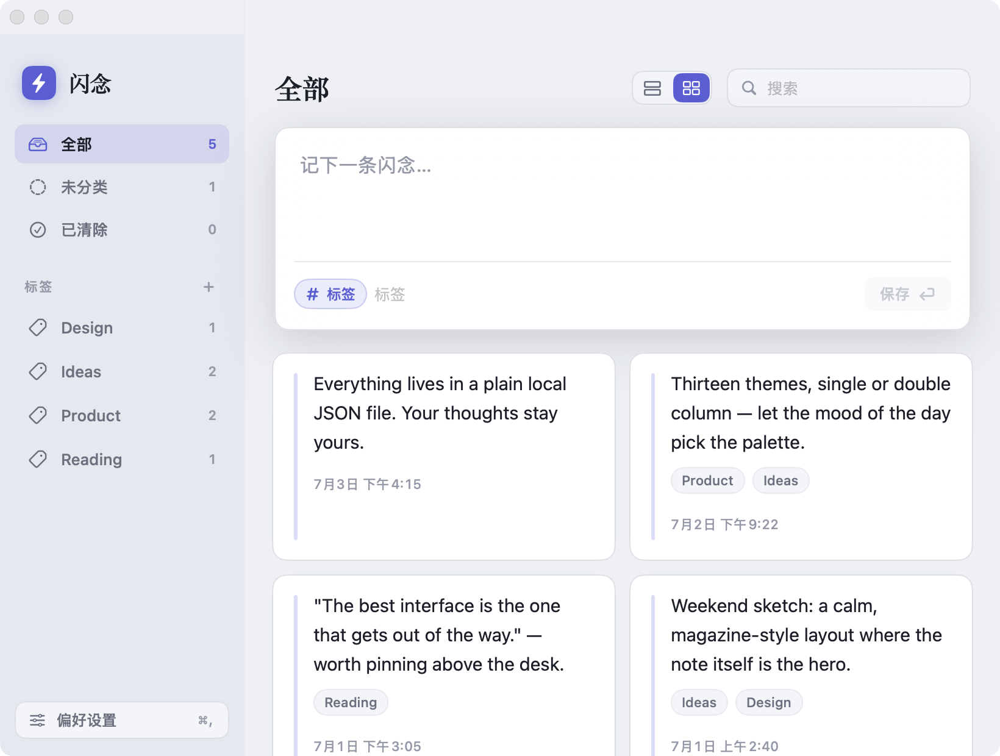
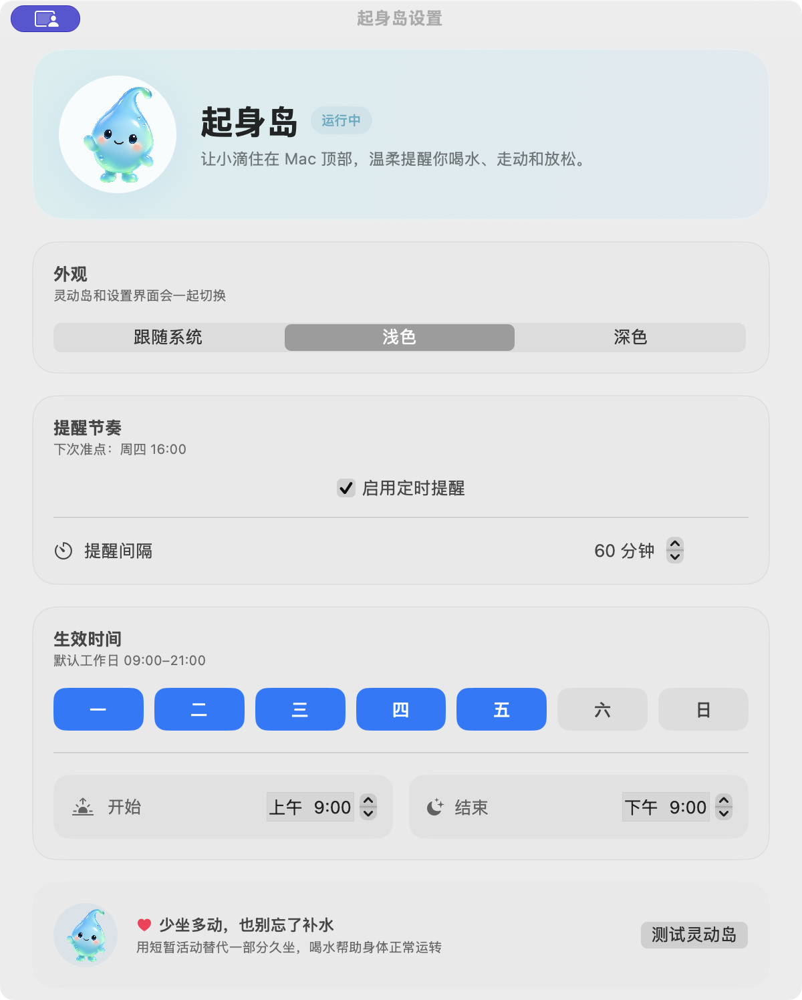
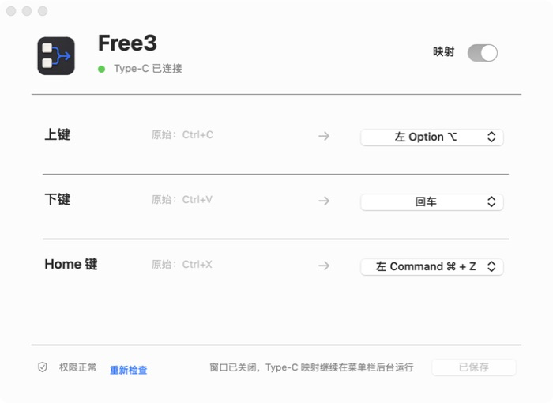
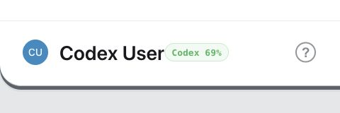
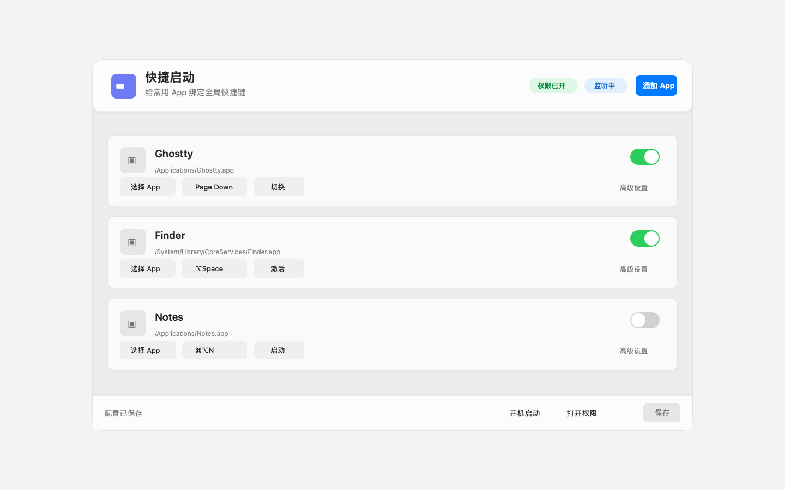

  

  <a href="./README.md">简体中文</a> · English · <a href="https://prozaclaputa.github.io/">Portfolio</a> · <a href="https://github.com/prozacLaputa?tab=repositories">All repositories</a>

# Hi, I'm Prozac

**An AI Builder making meta tools I genuinely need and playful software experiments worth finishing.**

I usually start with a concrete problem of my own: invisible thinking processes, hardware without a usable macOS client, or ideas lost while switching windows. Then I keep building until the result is usable, explainable, and open for others to inspect and extend.

## Original work

Every project below has a real, usable interface. Click a screenshot for its source, usage guide, live experience, or download.

<table>
  <tr>
    <td width="56%">
      
    </td>
    <td width="44%" valign="top">
      <h3><a href="https://github.com/prozacLaputa/vibe-canvas">Vibe Canvas</a></h3>
      
A live, local-first thinking canvas that grows beside Codex conversations while keeping conclusions traceable to the original words.

      
<code>Codex Plugin</code> <code>Local-first</code> <code>JavaScript</code>

      
<a href="https://github.com/prozacLaputa/vibe-canvas">Source and usage →</a>

    </td>
  </tr>
  <tr>
    <td width="56%">
      
    </td>
    <td width="44%" valign="top">
      <h3><a href="https://github.com/prozacLaputa/FlashThought">FlashThought</a></h3>
      
Captures fleeting thoughts through a global shortcut without breaking flow; every note stays in a plain local JSON file.

      
<code>macOS</code> <code>Swift</code> <code>Local-first</code>

      
<a href="https://github.com/prozacLaputa/FlashThought">Source and usage →</a>

    </td>
  </tr>
  <tr>
    <td width="56%">
      
    </td>
    <td width="44%" valign="top">
      <h3><a href="https://github.com/prozacLaputa/chaoshan-jiaobei">Chaoshan Jiaobei</a></h3>
      
A quiet, restrained 3D browser experience inspired by the Chaoshan jiaobei ritual.

      
<code>Web Experience</code> <code>Next.js</code> <code>CSS 3D</code>

      
<a href="https://prozaclaputa.github.io/chaoshan-jiaobei/">Live experience ↗</a> · <a href="https://github.com/prozacLaputa/chaoshan-jiaobei">Source →</a>

    </td>
  </tr>
  <tr>
    <td width="56%">
      
    </td>
    <td width="44%" valign="top">
      <h3><a href="https://github.com/prozacLaputa/pocket-observatory">Pocket Observatory / 口袋观测站</a></h3>
      
A quiet native macOS app for interest spending, text-only wishlists, and previewing the budget left after a purchase.

      
<code>macOS</code> <code>Swift</code> <code>Local-first</code>

      
<a href="https://github.com/prozacLaputa/pocket-observatory/releases/latest">Download ↗</a> · <a href="https://github.com/prozacLaputa/pocket-observatory">Source →</a>

    </td>
  </tr>
  <tr>
    <td width="56%">
      
    </td>
    <td width="44%" valign="top">
      <h3><a href="https://github.com/prozacLaputa/standup-island">StandUp Island</a></h3>
      
A tiny droplet living at the top of your Mac, gently reminding you to hydrate and move.

      
<code>macOS</code> <code>Swift</code> <code>Local-first</code>

      
<a href="https://github.com/prozacLaputa/standup-island/releases/latest">Download ↗</a> · <a href="https://github.com/prozacLaputa/standup-island">Source →</a>

    </td>
  </tr>
  <tr>
    <td width="56%">
      
    </td>
    <td width="44%" valign="top">
      <h3><a href="https://github.com/prozacLaputa/free3-mapper-macos">Free3 Mapper</a></h3>
      
Independent Type-C and Bluetooth key mapping for the Free3 device on macOS, without the vendor client.

      
<code>macOS</code> <code>Swift</code> <code>USB HID</code>

      
<a href="https://github.com/prozacLaputa/free3-mapper-macos/releases/latest">Download ↗</a> · <a href="https://github.com/prozacLaputa/free3-mapper-macos">Source →</a>

    </td>
  </tr>
  <tr>
    <td width="56%">
      
    </td>
    <td width="44%" valign="top">
      <h3><a href="https://github.com/prozacLaputa/stackchan-weiguang">Weiguang / 微光</a></h3>
      
A quiet StackChan desk companion for task updates, cat-like expressions, focus sessions and sticky notes.

      
<code>StackChan</code> <code>macOS</code> <code>USB / BLE</code>

      
<a href="https://github.com/prozacLaputa/stackchan-weiguang">Source and setup →</a>

    </td>
  </tr>
  <tr>
    <td width="56%">
      
    </td>
    <td width="44%" valign="top">
      <h3><a href="https://github.com/prozacLaputa/codex-decision-ui">Decision UI for Codex</a></h3>
      
Turns text choices into native clickable decisions only when judgment is genuinely required.

      
<code>Agent Skill</code> <code>Native UI</code> <code>Codex</code>

      
<a href="https://github.com/prozacLaputa/codex-decision-ui">Source and usage →</a>

    </td>
  </tr>
  <tr>
    <td width="56%">
      
    </td>
    <td width="44%" valign="top">
      <h3><a href="https://github.com/prozacLaputa/codex-usage-hud">Codex Usage HUD</a></h3>
      
Quietly keeps the remaining quota for the current usage window visible inside the Codex desktop app.

      
<code>macOS</code> <code>JavaScript</code> <code>Codex</code>

      
<a href="https://github.com/prozacLaputa/codex-usage-hud">Source and installation →</a>

    </td>
  </tr>
  <tr>
    <td width="56%">
      
    </td>
    <td width="44%" valign="top">
      <h3><a href="https://github.com/prozacLaputa/AppHotkeyTool">AppHotkeyTool</a></h3>
      
A lightweight macOS menu-bar launcher for opening, focusing, or hiding frequently used apps with global shortcuts.

      
<code>macOS</code> <code>Swift</code> <code>Global Hotkey</code>

      
<a href="https://github.com/prozacLaputa/AppHotkeyTool">Source and usage →</a>

    </td>
  </tr>
</table>

## How I build

- **Start with my own problem.** I do not begin with a fashionable technology and invent a need afterward.
- **Local-first and explainable.** Data stays on the device when possible, and AI conclusions should lead back to source text and explicit rules.
- **Finish before announcing.** Every public project has a real implementation, tests, or a verifiable path to use it.

---

  <a href="https://prozaclaputa.github.io/">Explore the portfolio</a>
  ·
  <a href="https://github.com/prozacLaputa?tab=repositories">View all repositories</a>
  ·
  <a href="https://github.com/prozacLaputa">GitHub</a>

